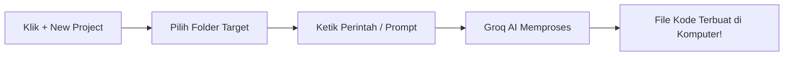

# ⚡ AI Workspace Assistant

<div align="center">


**Satu platform AI Coding Assistant generasi baru dengan antarmuka minimalis, responsif, dan interaktif.**  
Didesain khusus untuk membantu eksekusi kodingan cepat tanpa kerumitan IDE konvensional.

</div>

---

## 📸 Preview Antarmuka (UI/UX)

| 🖥️ Main Workspace Window | 📁 Interactive Folder Selector |
| :---: | :---: |
| *Panel Obrolan Utama, Workspace File Tree & Header Aksi* | *Modal Pop-Up Pemilihan Directory Lokal (`This PC`)* |

---

## 🚀 Fitur Unggulan

- 🎨 **Minimalist Dark Aesthetic**: Tampilan *Modern Dark Mode* berbasis Tailwind CSS dengan efek *glassmorphism* & aksen biru neon.
- 📁 **Direct Local File Creation**: Mengaitkan ruang kerja web secara langsung ke folder komputer target (misal: `E:\beljar`).
- 🤖 **Intelligent Code Generation**: Dipatenkan dengan LLM cerdas (Groq API) untuk merancang struktur berkas web (`index.html`, `style.css`, dll) dalam sekali perintah.
- ⚡ **Lightweight & Fast**: Jauh lebih ringan dibandingkan Visual Studio Code—fokus pada kecepatan pembuatan prototipe.
- 🔄 **Real-Time Interactive Chat**: Area prompt terintegrasi dengan penanda blok kode (*syntax highlighting*) yang bersih.

---

## 🛠️ Stack Teknologi

```
+-------------------------------------------------------+
|                    FRONTEND (UI/UX)                   |
|   React.js  •  Tailwind CSS  •  Lucide Icons  •  Vite |
+-------------------------------------------------------+
                           │
                 REST API / HTTP Requests
                           │
+-------------------------------------------------------+
|                    BACKEND (AGENT)                    |
|      Node.js  •  Express.js  •  Groq SDK  •  FS       |
+-------------------------------------------------------+
```

---

## 📂 Struktur Direktori

```
ai-workspace-assistant/
├── 📁 backend/
│   ├── 📄 workspaceAgent.js   # Logic eksekusi prompt ke Groq & Pembuat File
│   ├── 📄 server.js           # Server Express REST API
│   └── 📄 package.json
│
├── 📁 frontend/
│   ├── 📁 src/
│   │   ├── 📁 components/     # UI Components (Navbar, FileSidebar, ChatBox, FolderModal)
│   │   ├── 📄 App.jsx         # Kontainer Utama
│   │   └── 📄 main.jsx
│   ├── 📄 tailwind.config.js
│   └── 📄 package.json
│
└── 📄 README.md
```

---

## ⚡ Panduan Instalasi & Penggunaan

### 1️⃣ Setup Backend Server

```bash
# Masuk ke folder backend
cd backend

# Instalasi paket yang dibutuhkan
npm install

# Jalankan server API
node server.js
```

> **Catatan:** Jangan lupa buat file `.env` di folder `backend/`:
> ```env
> GROQ_API_KEY=masukkan_groq_api_key_kamu_di_sini
> PORT=5000
> ```

---

### 2️⃣ Setup Frontend App

```bash
# Buka terminal baru dan masuk ke folder frontend
cd frontend

# Instalasi dependensi
npm install

# Jalankan server pengembang
npm run dev
```

Buka **`http://localhost:5173`** pada browser pilihan kamu.

---

## 💡 Alur Kerja (Workflow)



1. Klik tombol **`+ New Project`** di bagian atas navbar.
2. Masukkan lokasi folder target pada sistem lokal kamu.
3. Berikan instruksi perintah koding pada kolom obrolan AI.
4. AI akan memproses dan membuat file kodingan fisik secara instan!

---

<div align="center">
  <sub>Built with ❤️ for rapid prototyping and effortless coding.</sub>
</div>
